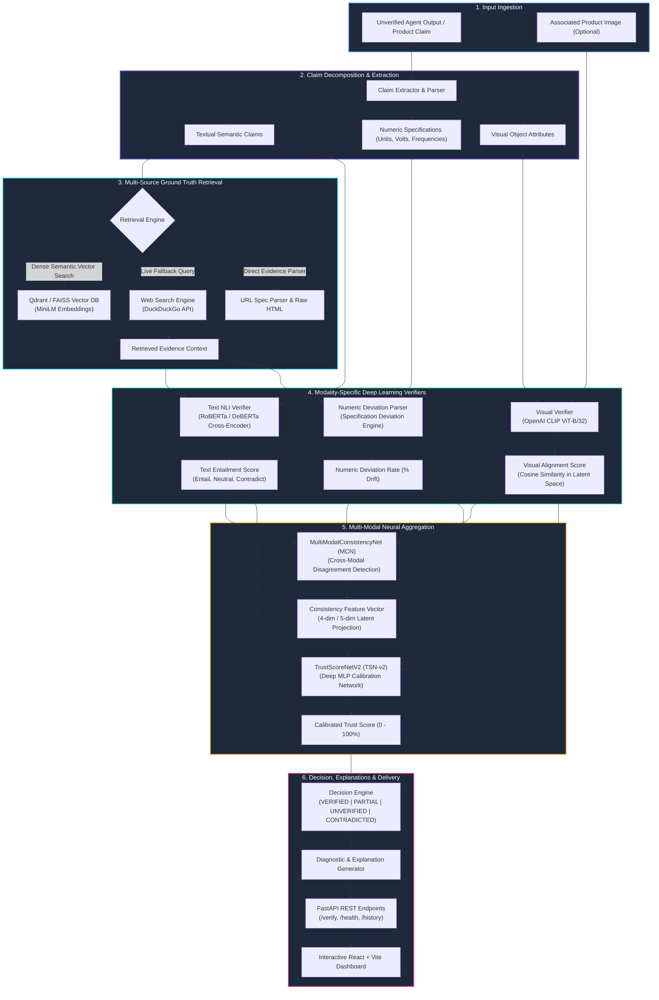

# 🛡️ TrustAgent: Autonomous Multi-Modal AI Verification Layer

[](https://www.python.org/)
[](https://pytorch.org/)
[](https://fastapi.tiangolo.com/)
[](https://reactjs.org/)
[](https://huggingface.co/)
[](https://qdrant.tech/)

> **TrustAgent** is an end-to-end deep learning verification framework designed to validate, cross-examine, and calibrate the trustworthiness of outputs generated by autonomous AI agents and e-commerce product claims across multimodal data (textual specifications, visual imagery, and numeric claims).

---

## 🏛️ System Architecture

The following diagram illustrates the complete data flow, from raw unstructured claims to the calibrated multidimensional trust assessment:



---

## 🔬 Core Components & Deep Learning Pipeline

### 1. Claim Decomposition & Extraction (`pipeline/claim_extractor.py`)
- Unpacks raw unstructured text into discrete, testable atomic claims.
- Isolates qualitative claims from quantitative metrics (e.g., `"250mW"`, `"5.8GHz"`, `"4K resolution"`, `"12-hour battery"`).

### 2. Multi-Tier Ground Truth Retrieval (`retrieval/`)
- **Dense Vector Search**: Powered by `sentence-transformers/all-MiniLM-L6-v2` with Qdrant and FAISS indexing real e-commerce catalogs.
- **Dynamic Web Fallback**: Real-time query execution via DuckDuckGo and domain-specific HTML scrapers when knowledge base coverage is sparse.

### 3. Modality Verifiers (`models/`)
- **Textual NLI Cross-Encoder**: Utilizes state-of-the-art transformer NLI (Natural Language Inference) models to compute rigorous entailment, neutral, and contradiction probabilities against retrieved ground truth passages.
- **Visual Verifier (OpenAI CLIP ViT-B/32)**: Projects image pixels and visual claim strings into a shared multimodal embedding space, computing cosine similarity to verify whether images truthfully depict claimed product specs.
- **Numeric Deviation Engine (`numeric_parser.py`)**: Quantifies discrepancy between claimed numbers and ground truth values, penalizing deceptive statistical inflation or falsified capacities.

### 4. MultiModalConsistencyNet (MCN)
- Specialised feed-forward neural network trained to detect cross-modal conflict (e.g., where text claims one feature but image evidence contradicts it).
- Produces a calibrated cross-modal consistency embedding.

### 5. TrustScoreNetV2 (TSN-v2)
- Multi-layer neural network with batch normalization, dropout, and residual pathways.
- Takes the fused features (Text NLI confidence, CLIP visual similarity, numeric deviation metrics, cross-modal consistency flags) and maps them to a calibrated Trust Score from **0.0% to 100.0%**.

### 6. Veracity Categories & Decision Engine
| Status | Score Threshold | Meaning |
| :--- | :---: | :--- |
| **`VERIFIED`** | $\ge 80\%$ | Fully supported by both multimodal evidence and ground truth data. |
| **`PARTIALLY_VERIFIED`**| $55\% - 79\%$ | Core claim supported, but minor numeric deviation or unconfirmed specs exist. |
| **`UNVERIFIED`** | $35\% - 54\%$ | Insufficient grounding evidence found in verified catalogs or web search. |
| **`CONTRADICTED`** | $< 35\%$ | Direct factual contradiction detected between claim and ground truth. |

---

## 📂 Repository Structure

```
Deep-learning-CP-2/
├── backend/                  # FastAPI Application
│   ├── main.py               # REST API endpoints & CORS config
│   └── database.py           # SQLite persistence layer
├── frontend/                 # Modern React + Vite Dashboard
│   ├── src/                  # Dashboard components, UI styles & state
│   ├── index.html            # Main HTML layout
│   └── package.json          # Frontend dependencies
├── models/                   # Deep Learning Neural Architectures
│   ├── text_verifier/        # Transformer NLI models & inference
│   ├── image_verifier/       # CLIP ViT-B/32 multimodal verification
│   ├── consistency_net/      # MultiModalConsistencyNet architecture & checkpoints
│   └── trust_score_net/      # TrustScoreNetV2 training scripts & model checkpoints
├── pipeline/                 # Core Pipeline Orchestration
│   ├── claim_extractor.py    # Claim extraction & parsing
│   ├── ecommerce_analyzer.py # Decomposition & multi-claim aggregation
│   ├── decision.py           # Threshold-based decision logic
│   └── run.py                # End-to-end execution pipeline
├── retrieval/                # Dense Retrieval & Vector Database
│   ├── retrieve.py           # Query retrieval orchestrator
│   ├── web_search.py         # DuckDuckGo fallback scraper
│   └── url_scanner.py        # Direct URL content extraction
├── teacher_proof_demo.py     # Live interactive verification demonstration
├── test_system_health.py     # System health and sanity check suite
└── README.md                 # Project documentation
```

---

## 🚀 Quick Start Guide

### 1. Prerequisites
- Python 3.10+
- Node.js 18+ and npm
- Git

### 2. Backend Setup
```bash
# Clone the repository
git clone https://github.com/rushirathod22/Deep_Learning_Project.git
cd Deep_Learning_Project

# Create and activate a virtual environment
python -m venv venv

# On Windows:
.\venv\Scripts\activate

# On Linux/macOS:
source venv/bin/activate

# Install Python dependencies
pip install -r requirements.txt

# Start the FastAPI server
uvicorn backend.main:app --host 0.0.0.0 --port 8000 --reload
```
API docs will be accessible at: `http://localhost:8000/docs`

### 3. Frontend Setup
```bash
# In a new terminal, navigate to the frontend directory:
cd frontend

# Install npm packages
npm install

# Start the Vite development server
npm run dev
```
Open your browser at: `http://localhost:5173`

---

## 🧪 Live Proof & Validation

To execute live verification tests proving that the system reads real ground truth rather than guessing:

```bash
# Run the teacher proof demonstration
python teacher_proof_demo.py

# Run the full system health check
python test_system_health.py
```

---

## 📜 License & Acknowledgments
Developed as part of the Deep Learning Course Project. Powered by PyTorch, Hugging Face Transformers, OpenAI CLIP, and Qdrant.
